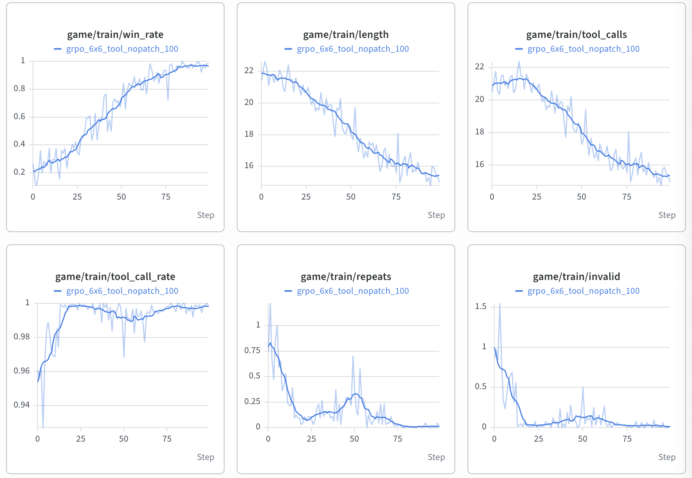

# Plane Strike with Gemma 4 E2B + agentic RL (Tunix)

Agentic RL using the environment from a previous blog["Building a reinforcement learning agent with JAX, and deploying it on Android with TensorFlow Lite"](https://blog.tensorflow.org/2022/09/building-reinforcement-learning-agent-with-JAX-and-deploying-it-on-android-with-tensorflow-lite.html) + an LLM agent, which uses Gemma 4 E2B (thinking mode on) to play the game in a multi-turn
conversation and is fine-tuned with GRPO.

## Sample run

Train metrics of a 100-step run with the defaults below: win rate 0.17 -> 0.95,
game length 22 -> ~15.7 strikes, repeats and invalid strikes down to ~0.



## Running

```bash
# Train for 100 steps (default --num_steps 100; resumes from the latest checkpoint if present).
# Defaults: turn-level advantages, per-turn cap 2048, soft overlong penalty from
# 512, lr held to step 40 then cosine decay to --lr_end at --num_steps.
python train_planestrike.py \
  --run_dir runs/grpo_6x6_tool_soft512_100 \
  --learning_rate 2e-6 \
  --lr_end 2e-7
```

## Tested nvironment

TPU v6e-8 single host with Python 3.12:

| package | version |
|---|---|
| Tunix | [`google/tunix@144717f`](https://github.com/google/tunix/commit/144717f073ebe5dfc28020e075f1b3ad9ab04db1) (2026-10-07) |
| JAX / jaxlib | 0.11.0 |
| Flax | 0.12.8 |
| vLLM | 0.29.0 (`vllm-tpu`, with `tpu_inference` 0.29.0) |
| libtpu | 0.0.44 |

## Files

| File | Purpose |
|---|---|
| `env.py` | `PlaneStrikeEnv(BaseTaskEnv)`: the original game on a 6x6 board (same plane placement code as `common.py`), capped at 23 strikes (`env.MAX_STEPS`). |
| `agent.py` | `PlaneStrikeAgent(ConversationAgentBase)`: system prompt (rules only), per-turn board message with the "don't strike tried cells" reminder, and turning the model's `strike` tool call (after the thought channel) into the env action. |
| `strike_tool.py` | The `strike` tool (`BaseTool`: `strike(cell="C5")` returns ```` ```C5``` ````), Gemma 4 tool-call parsing, and a `Gemma4ChatTemplateParser` subclass that adds the native tool declaration and renders strike results as in-turn tool responses. |
| `train_planestrike.py` | Agentic GRPO training (Tunix `GRPOLearner`, vLLM rollout, mesh (fsdp, tp) = (8, 1)). Boards are generated on the fly from seeds. |
| `turn_credit.py` | Turn-level GRPO advantages (per-strike discounted returns, group-normalized), over-budget trimming, truncation penalty. |

## Game, observation, reward

* Rules as in the original gym env, but on a **6x6 board**: one
  8-cell plane in one of 4 headings (45 distinct placements), one strike per
  turn; the game ends when all 8 cells are hit, or after **23 strikes**. 
  The plane covers 8 of 36 cells.
* Observation each turn: result of the last strike, strikes used, and the raw
  visible board (`.` untried, `X` hit, `O` miss). Nothing derived from the
  board (no candidate cells, no hit counts, no heat map / probabilities).
* The system prompt states only the rules (board, the plane's shape and that
  it can head 4 ways, symbols, and that strikes are made with the `strike`
  tool). No strategy and no hints about symmetry. Each turn's message reminds
  the model not to strike tried cells.
* Strikes are tool calls, in Gemma 4's native format: the system prompt carries
  the tool's `<|tool>declaration:strike{...}<tool|>` (rendered by the model's
  own chat template), and a turn ends with
  `<|tool_call>call:strike{cell:<|"|>C5<|"|>}<tool_call|><|tool_response>`
  (`<|tool_response>` is a Gemma 4 stop token). The tool only wraps the cell
  in triple backticks; that output is parsed into the action. The strike result
  and the new board come back as the tool response
  (`response:strike{value:<|"|>...<|"|>}<tool_response|>`) and the model
  continues in the same turn, so a game is one model turn with one tool call
  per strike. A strike counts only if the final answer (after the thought)
  makes exactly one `strike` call; a ```` ```C5``` ```` written as text, a
  missing or second call, or an off-board cell is an invalid strike. After a
  turn that ends with `<turn|>` instead, the board comes back as a user message.
* Pre-RL baseline with the tool (32 held-out 6x6 games): game length 22.44,
  win rate 9.4%, 6.22 hits, 0.84 repeats and 0.84 invalid strikes per game;
  255 tokens per turn (p99 1.5k), 8.3k tokens per game (max 11.8k), no
  truncated games.
* Per-strike reward: hit +1, miss 0, repeated cell -1, unparseable answer -1,
  and -0.5 per strike. The trajectory reward is the sum, i.e.
  `hits - 0.5 * game_length - repeats - invalid`. Every unfinished game has
  length 23, so the step cost only separates finished games: shorter is better.

## Credit assignment: turn-level GRPO

Tunix's agentic GRPO gives every token of a game the same advantage (from the
episode's total reward). A first run with that setting (30-strike cap, 30 steps)
barely moved: train game length stayed ~28.5 while entropy fell 0.33 -> 0.19
and thinking grew 7.9k -> 13k tokens per game. With ~30 turns sharing one
advantage, the outcome is dominated by luck in finding the plane.

The original JAX example rewards each strike with discounted returns
(`common.compute_rewards`, `GAMMA = 0.5`). `turn_credit.py` does the same
inside GRPO, still critic-free and group-relative:

    G_t = r_t + 0.5 * G_{t+1}                      per turn of each game
    A_t = (G_t - mean) / std                       over all turns of the 8 games on one board

and every token generated in turn t gets `A_t` (Tunix's loss already accepts
`[batch, length]` advantages). Selected with `--advantage_mode turn` (default);
`--advantage_mode trajectory` is the stock behavior.


